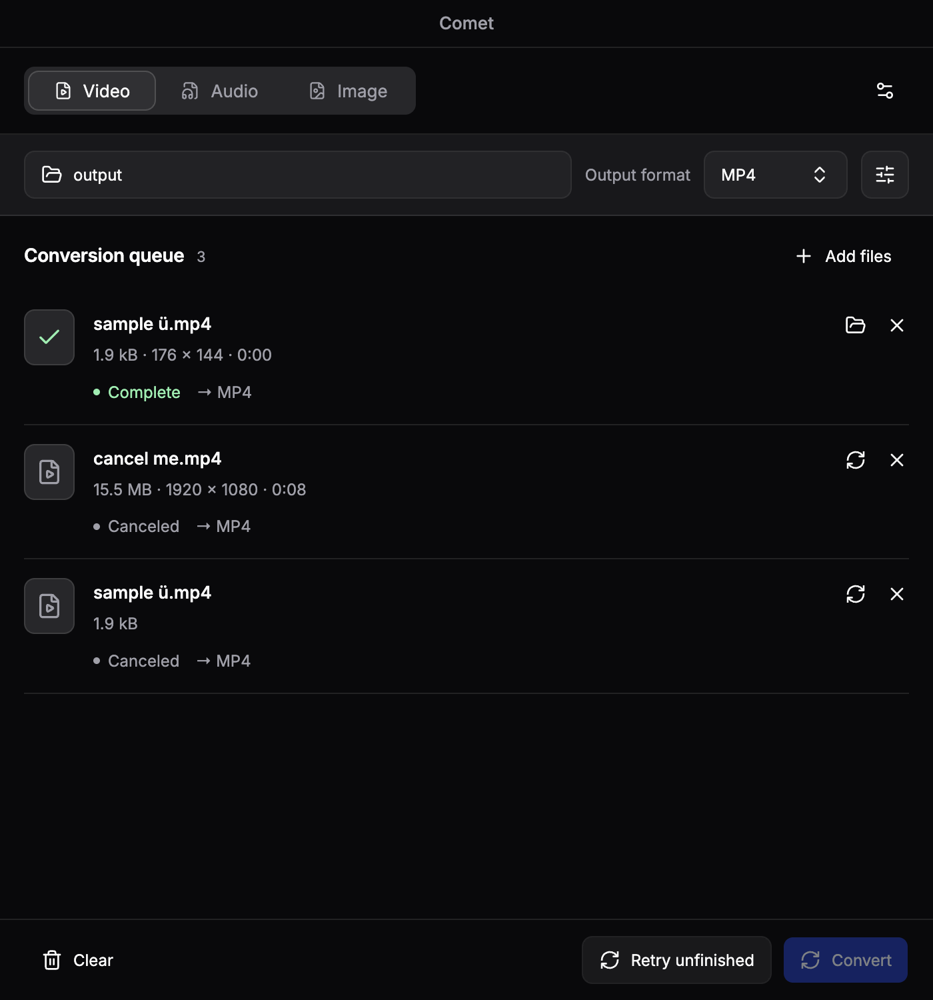

# Comet

A local media converter for video, audio, and images, built with React,
Electron, FFmpeg and Jimp. Your media stays on your device; conversion needs no
account or network service.

Comet is being modernized from its Vue application. The repository now separates
the desktop interface, conversion engine, and shared contracts. Marketing and
documentation applications will follow later.



## Development

Use the pinned Node and npm versions:

```sh
nvm install
nvm use
npm install -g npm@12.2.0
npm ci
npm run dev
```

The first launch downloads the pinned, checksum-verified media tools for your
native OS/architecture. Later launches use the verified local cache. End-user
packages contain the tools and do not download them at runtime.

| Command                     | Purpose                                                          |
| --------------------------- | ---------------------------------------------------------------- |
| `npm run dev` / `npm start` | Desktop development with shared-package watchers                 |
| `npm run lint`              | ESLint, hooks/accessibility rules and workspace boundaries       |
| `npm run typecheck`         | All workspace types                                              |
| `npm test`                  | Contract, engine, bridge, preference and React tests             |
| `npm run build`             | Production JavaScript/CSS bundles and library outputs            |
| `npm run binaries`          | Stage verified native FFmpeg/FFprobe resources                   |
| `npm run test:matrix`       | All supported native source/output pairs with coverage reports   |
| `npm run test:e2e`          | Shared Playwright desktop suite against the current build        |
| `npm run test:integration`  | Real media fixtures against the staged tools; run build first    |
| `npm run package`           | Package the desktop application for the native target            |
| `npm run test:packaged`     | Verify resources/imports, then test an isolated application copy |
| `npm run make`              | Create platform distributables                                   |

Linux needs the desktop runtime libraries, `rpm`, `fakeroot`, and Xvfb for
headless packaged testing. Use `xvfb-run --auto-servernum npm run test:packaged`
in a headless environment. Packaging and media resources must target the same
architecture.

## Workspaces

```text
apps/desktop          Electron main/preload, React renderer and packaging
packages/engine       Electron-free conversion scheduler and adapters
packages/contracts    Browser-safe runtime validation and shared types
packages/ui           Shared shadcn components, tokens and typography
packages/e2e          Shared Playwright tests, drivers and media fixtures
```

The engine owns the queue. Video, audio and image have separate batches, with
one conversion active globally. Cancel batch affects only the selected tab;
per-file cancellation leaves its siblings running. Submitted settings stay
fixed. Original files are preserved and colliding outputs receive unique names.

The refreshed UI supports light/dark/system appearance and English, Spanish,
French, German and Russian. Preferences survive restarts; active jobs do not
restart automatically. Animated/multipage images require explicit first-frame
consent, and removing transparency requires flattening consent.

Output availability reflects the encoders/muxers included in each pinned native
build. The integration suite executes every output marked available. Unsupported
formats remain visible but disabled.

The shared [E2E workspace](packages/e2e/README.md) verifies source/output pairs,
video audio-extraction/frame-saving, and every enabled format through the
packaged desktop UI. Reports distinguish unavailable outputs, expected missing
tracks, untested input fixtures, and failures. AMR, APE, and MPC still need
input fixtures on macOS ARM64; use the documented strict coverage flag before
claiming all accepted inputs are tested. The web app can reuse the configuration
and page actions once its real conversion workflow exists.

## Releases

The intended release matrix is macOS, Windows and Linux, each x64 and ARM64.
Only targets with passing native packaged verification should be distributed.
Local verification does not establish support for another OS/architecture.
Existing releases are available on
[GitHub](https://github.com/Thavarshan/comet/releases).

Comet's application code is MIT licensed. Bundled media executables carry their
own licenses and source notices, included alongside the tools. See
[LICENSE](LICENSE) and the pinned binary provenance manifest.

### CI and release builds

Pull requests and branch builds enter a shared quality gate (80-column
formatting, ESLint and workspace boundaries, TypeScript, release tooling tests,
and a production dependency audit). CodeQL runs security-extended analysis on
TypeScript/JavaScript and Actions workflows; high severity findings block
builds. Development dependency audit findings are retained as a separate report.

Native jobs run unit tests, real conversion integration tests, the conversion
pair matrix, and isolated packaged Playwright tests on macOS, Windows, and
Ubuntu, each on x64 and ARM64. Tests use the bundled conversion tools.
Playwright reports, failure screenshots, traces, and conversion coverage are
retained for 14 days. No test retries conceal intermittent failures.

The Linux compatibility stage runs the same packaged desktop tests under Xvfb in
Debian 12/13, Ubuntu 22.04, Fedora 43, and openSUSE Leap 16 containers on both
architectures, plus Arch on x64. Ubuntu 24.04 is covered by the native jobs.
These are explicit tested environments, not a guarantee for every Linux distro.
Alpine/musl, Wayland compositors, and real desktop integration are outside this
container matrix. Containers run the app as an unprivileged user with Chromium's
sandbox; extra container capabilities are limited to disposable CI containers.
Images track their named distribution so updates can expose compatibility
regressions. Package installation/OS integration still needs release acceptance
checks on actual desktops.

Build outputs are macOS ZIPs, Windows Squirrel installers and portable ZIPs, and
Linux DEB, RPM, and portable tar archives. `npm run make` invokes Forge;
`npm run dist:portable` adds the Linux tar with executable modes preserved.
Packaging and native tests are uncached; npm downloads are cached per lockfile.
The centralized `@comet/e2e` helpers can also support a future web application;
there is no web application test project until that application exists.

A `v<desktop version>` tag runs the full pipeline with signing enabled. Only
successful native and distro verification unlock the `release` environment's
publish job. It checks every target's commit/version receipt and artifact
hashes, creates a draft, uploads all distributions plus `SHA256SUMS`, then
publishes. Tags containing a prerelease suffix publish as prereleases; stable
tags become latest. Already published releases cannot be overwritten. PR
workflows never publish and receive no signing credentials.

Before the first release, configure the GitHub `release` environment with tag
restrictions and any required reviewers, and protect the required CI checks.
Signing jobs need repository secrets `APPLE_CERTIFICATE_BASE64`,
`APPLE_CERTIFICATE_PASSWORD`, `APPLE_IDENTITY`, `APPLE_ID`,
`APPLE_APP_SPECIFIC_PASSWORD`, `APPLE_TEAM_ID`, `WINDOWS_CERTIFICATE_BASE64`,
and `WINDOWS_CERTIFICATE_PASSWORD`. Certificates are loaded temporarily and
cleaned after each job. Enable GitHub code scanning for the repository.
Dependabot proposes weekly dependency and Action updates; changes are never
automatically merged.

The conversion matrix records unavailable encoders and missing fixtures as
explicit coverage gaps. AMR, APE, and MPC input fixtures still need to be
supplied before claiming complete accepted-input coverage.
`COMET_MEDIA_FIXTURES` supplies those fixtures; `COMET_REQUIRE_INPUT_COVERAGE=1`
makes missing coverage fail.
