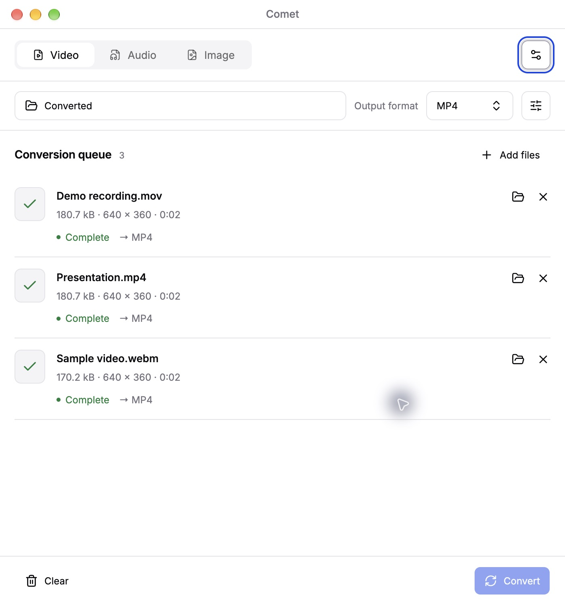
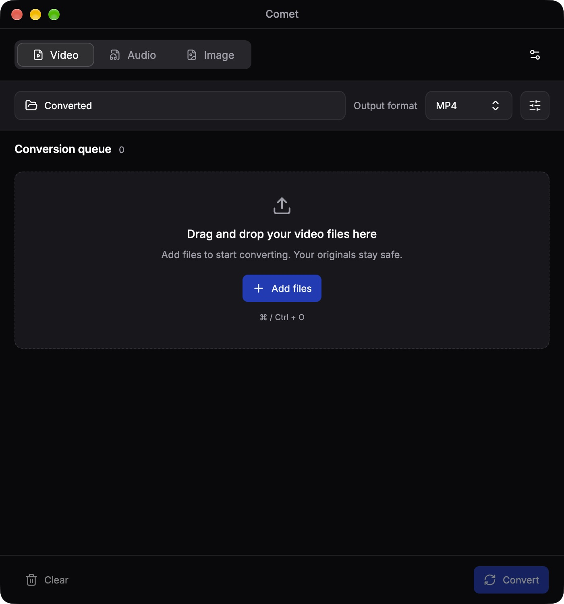
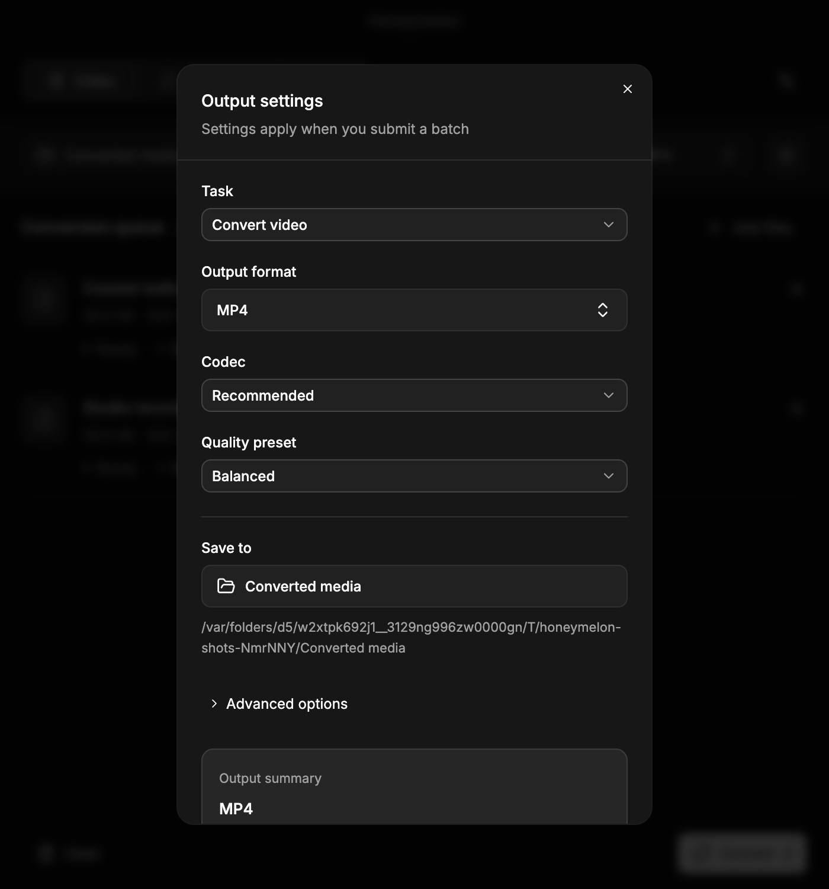

# Comet

A compact desktop app for converting video, audio, and images. Choose your
files, pick an output format, and convert them locally with bundled media tools.
No account, upload, or cloud processing is required.

[Download stable](https://github.com/Thavarshan/comet/releases/latest) ·
[Release notes](CHANGELOG.md) · [Contribute](.github/CONTRIBUTING.md)

> **Unsigned beta:**
> [v3.0.0-beta.1](https://github.com/Thavarshan/comet/releases/tag/v3.0.0-beta.1)
> is available for testing with the React interface shown below. macOS builds
> are not Developer ID signed or notarized; Windows installers are not
> Authenticode signed, so operating-system trust warnings are expected. Verify
> downloads with the release's `SHA256SUMS`. v2.2.3 remains the latest stable
> release and uses the previous interface.

<picture>
  <source
    media="(prefers-color-scheme: dark)"
    srcset="assets/screenshots/desktop-dark.png"
  />
  
</picture>

Native macOS captures of `3.0.0-beta.1`, using generated demo files. The light
view shows completed conversions; the dark view shows files ready to convert.

<details>
<summary>More screenshots: adding files and output settings</summary>

| Add your media                                                                            | Configure the output                                                                                                   |
| ----------------------------------------------------------------------------------------- | ---------------------------------------------------------------------------------------------------------------------- |
|  |  |

</details>

## What you can do

- Convert multiple files with drag and drop or the file picker (`⌘/Ctrl + O`).
- Convert video, extract an audio track, or save a video frame as an image.
- Choose compatible codecs, quality presets, dimensions, and frame rates.
- Configure audio bitrate, sample rate, channels, and supported PCM bit depths.
- Resize images, choose quality, and control transparency or first-frame
  handling.
- Monitor each file, cancel a file or the current tab’s batch, and retry
  failures.
- Reveal completed files in their folder. Original files are never overwritten;
  existing output names receive a collision suffix.
- Use light, dark, or system appearance and English, Spanish, French, German, or
  Russian. Preferences are saved across launches.

Available output formats depend on the encoders and muxers bundled for your
platform. Common choices include MP4, MKV, WebM, MOV, MP3, WAV, FLAC, PNG, JPEG,
WebP, and AVIF. The format picker explains unavailable outputs. This is not a
promise that every media type can convert into every other media type.

## Convert a file

1. Select **Video**, **Audio**, or **Image**, then add your source files.
2. Choose the destination folder and output format.
3. Open **Output settings** for the task, codec, quality, and advanced controls.
4. Press **Convert**. Each submitted batch keeps its original settings while
   files added later remain drafts for the next batch.

Video, audio, and image keep separate batches with one active conversion across
all tabs. Canceling a batch affects that tab. Application restarts begin with an
empty queue and never replay previous conversions automatically.

## Run from source

Use the pinned Node 24.22.0 and npm 12.2.0 versions:

```sh
nvm install
nvm use
npm install -g npm@12.2.0
npm ci
npm run dev
```

The first development launch downloads pinned, checksum-verified FFmpeg and
FFprobe binaries. Later launches reuse the verified local cache. Distributed
applications include these tools and do not fetch them at runtime.

| Command                     | Purpose                                                      |
| --------------------------- | ------------------------------------------------------------ |
| `npm run dev` / `npm start` | Run desktop development with package watchers                |
| `npm run format:check`      | Check the 80-column formatting rules                         |
| `npm run lint`              | Build package types, then lint code and workspace boundaries |
| `npm run typecheck`         | Check TypeScript across the workspaces                       |
| `npm test`                  | Run contract, engine, bridge, preference, and React tests    |
| `npm run test:ci`           | Test release policies and download security boundaries       |
| `npm run build`             | Build renderer bundles and shared packages                   |
| `npm run binaries`          | Stage verified native conversion tools                       |
| `npm run test:integration`  | Convert real fixtures with the staged tools                  |
| `npm run test:matrix`       | Exercise source/output pairs and report coverage gaps        |
| `npm run test:e2e`          | Run desktop Playwright tests against the built app           |
| `npm run package`           | Package the app for the host OS and architecture             |
| `npm run make`              | Create platform distributables                               |
| `npm run dist:portable`     | Add the Linux portable tar archive after packaging           |
| `npm run test:packaged`     | Verify and test an isolated packaged app after make          |

For native integration/matrix testing, run `npm run build` and
`npm run binaries` first. Linux packaging needs `rpm` and `fakeroot`; headless
E2E also needs the desktop runtime libraries and Xvfb. Use
`xvfb-run --auto-servernum npm run test:packaged` on a headless Linux host.
Packaging and native tools must target the same architecture.

## Repository structure

```text
apps/desktop          Electron main/preload, React renderer, packaging
packages/engine       Electron-free scheduling and conversion execution
packages/contracts    Browser-safe validation and shared domain types
packages/ui           Shared shadcn components, theme, and typography
packages/e2e          Playwright drivers, media fixtures, and desktop tests
```

The engine owns submitted jobs and scheduling. Electron main owns preferences,
resource discovery, native dialogs, and the validated IPC bridge. React displays
queue snapshots and submits commands through the narrow preload API.

The shared UI uses the Comet shadcn preset with medium radii, Radix primitives,
Inter typography, tooltips, dialogs, popovers, and Scroll Area. Marketing,
documentation, and web applications are planned; they do not exist yet.

See the [E2E workspace guide](packages/e2e/README.md) for fixture coverage,
strict-mode checks, reports, and future web test reuse. The suite distinguishes
unsupported encoders, missing tracks, missing input fixtures, and actual
failures. AMR, APE, and MPC fixture coverage varies by native build; do not
claim complete accepted-input coverage while gaps remain.

## Builds and releases

The target matrix is macOS, Windows, and Linux on x64 and ARM64. A target is
eligible for distribution only after its native packaged checks pass.

| Platform | Distributables                      |
| -------- | ----------------------------------- |
| macOS    | ZIP application bundle              |
| Windows  | Squirrel installer and portable ZIP |
| Linux    | DEB, RPM, and portable tar archive  |

Pull requests run formatting, lint, static security analysis, dependency checks,
unit/integration tests, conversion-pair coverage, and packaged desktop E2E.
Additional Linux compatibility jobs cover named Debian, Ubuntu, Fedora,
openSUSE, and Arch environments. A passing container test does not verify every
Linux distribution, compositor, or desktop integration.

<details>
<summary>CI matrix, signing, and release maintenance</summary>

Pull requests and branch builds enter a shared quality gate (80-column
formatting, ESLint and workspace boundaries, TypeScript, release tooling tests,
and a production dependency audit). CodeQL runs security-extended analysis on
TypeScript/JavaScript and Actions workflows; high severity findings block
builds. Development dependency audit findings are retained as a separate report.

Native jobs run unit tests, real conversion integration tests, the conversion
pair matrix, and isolated packaged Playwright tests on macOS, Windows, and
Ubuntu, each on x64 and ARM64. Tests use the bundled conversion tools.
Playwright reports, failure screenshots, traces, and conversion coverage are
retained for 14 days. No test retries conceal intermittent failures.

The Linux compatibility stage runs the same packaged desktop tests under Xvfb in
Debian 12/13, Ubuntu 22.04, Fedora 43, and openSUSE Leap 16 containers on both
architectures, plus Arch on x64. Ubuntu 24.04 is covered by the native jobs.
These are explicit tested environments, not a guarantee for every Linux distro.
Alpine/musl, Wayland compositors, and real desktop integration are outside this
container matrix. Containers run the app as an unprivileged user with Chromium's
sandbox; extra container capabilities are limited to disposable CI containers.
Images track their named distribution so updates can expose compatibility
regressions. Package installation/OS integration still needs release acceptance
checks on actual desktops.

Build outputs are macOS ZIPs, Windows Squirrel installers and portable ZIPs, and
Linux DEB, RPM, and portable tar archives. `npm run make` invokes Forge;
`npm run dist:portable` adds the Linux tar with executable modes preserved.
Packaging and native tests are uncached; npm downloads are cached per lockfile.
The centralized `@comet/e2e` helpers can also support a future web application;
there is no web application test project until that application exists.

A `v<desktop version>` tag runs the full pipeline with signing enabled. Only
successful native and distro verification unlock the `release` environment's
publish job. It checks every target's commit/version receipt and artifact
hashes, creates a draft, uploads all distributions plus `SHA256SUMS`, then
publishes. Tags containing a prerelease suffix publish as prereleases; stable
tags become latest. Already published releases cannot be overwritten. PR
workflows never publish and receive no signing credentials.

Before the first release, configure the GitHub `release` environment with tag
restrictions and any required reviewers, and protect the required CI checks.
Signing jobs need repository secrets `APPLE_CERTIFICATE_BASE64`,
`APPLE_CERTIFICATE_PASSWORD`, `APPLE_IDENTITY`, `APPLE_ID`,
`APPLE_APP_SPECIFIC_PASSWORD`, `APPLE_TEAM_ID`, `WINDOWS_CERTIFICATE_BASE64`,
and `WINDOWS_CERTIFICATE_PASSWORD`. Certificates are loaded temporarily and
cleaned after each job. Enable GitHub code scanning for the repository.
Dependabot proposes weekly dependency and Action updates; changes are never
automatically merged.

The conversion matrix records unavailable encoders and missing fixtures as
explicit coverage gaps. AMR, APE, and MPC input fixtures still need to be
supplied before claiming complete accepted-input coverage.
`COMET_MEDIA_FIXTURES` supplies those fixtures; `COMET_REQUIRE_INPUT_COVERAGE=1`
makes missing coverage fail.

</details>

## License

Comet’s application code is [MIT licensed](LICENSE). Bundled media executables
have their own licenses and source notices, shipped alongside the tools. Their
versions, upstream sources, and checksums are recorded in the
[binary manifest](scripts/binary-manifest.json).
